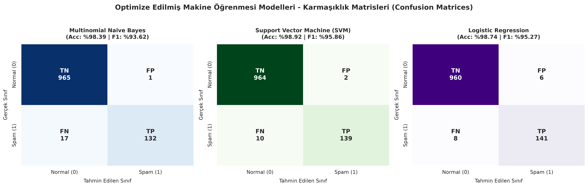
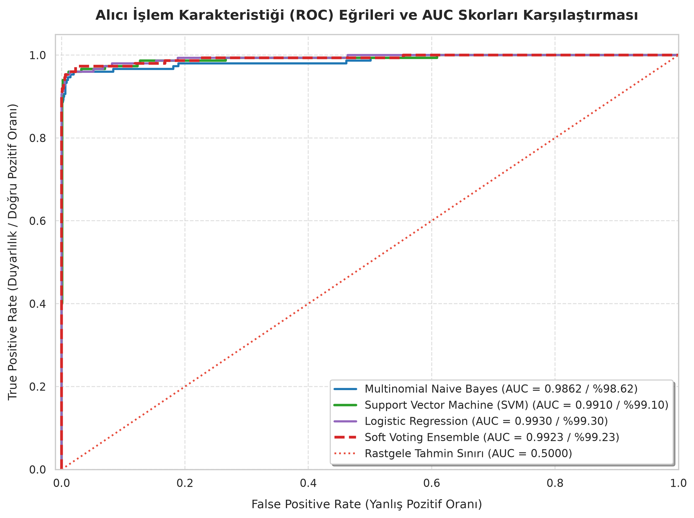

# SPAM TESPİTİ VE MAKİNE ÖĞRENMESİ ÖDEV RAPORU

**Uygulama Betiği:** [spam_classifier.py](spam_classifier.py)  
**Üretilen Grafikler:** [confusion_matrices.png](confusion_matrices.png) | [roc_curves.png](roc_curves.png)  

---

## 1. SPAM VEYA NORMAL MAIL DATASET (VERİ SETİ)

Ödev için açık kaynaklı ve standart kabul edilen **SMS / E-Posta Spam Collection** veri seti kullanılmıştır.

* **Kaynak:** `https://raw.githubusercontent.com/justmarkham/pycon-2016-tutorial/master/data/sms.tsv`
* **Toplam Veri Sayısı:** 5.572 adet mesaj
  * **Normal (Ham - 0):** 4.825 adet (%86.59)
  * **Spam (1):** 747 adet (%13.41)
* **Eğitim ve Test Bölümü:**
  * **Eğitim Kümesi (%80 Train):** 4.457 mesaj
  * **Test Kümesi (%20 Test):** 1.115 mesaj (966 Normal, 149 Spam)
  * *(Sınıf dengesini korumak için `stratify` kullanılarak her iki kümede de %86.6 - %13.4 oranı eşit tutulmuştur.)*

---

## 2. EN AZ 3 MAKİNE ÖĞRENMESİ ALGORİTMASINDA BU VERİ SETİNİN EĞİTİLMESİ

Veri seti metin sınıflandırmada en çok tercih edilen 3 güçlü makine öğrenmesi algoritması ile eğitilmiştir:

1. **Support Vector Machine (SVM):** Metin gibi binlerce kelimeden oluşan yüksek boyutlu uzaylarda iki sınıfı birbirinden en geniş aralıkla ayıran hiper-düzlemi bulur.
2. **Multinomial Naive Bayes (MNB):** Kelimelerin frekanslarına ve Bayes olasılık kuralına dayanır; metin sınıflandırmada çok hızlı ve etkilidir.
3. **Logistic Regression:** Mesajın spam olma olasılığını Sigmoid fonksiyonu ile $[0, 1]$ aralığında hesaplar.
4. *(Bonus)* **Soft Voting Ensemble:** Bu 3 modelin tahmin olasılıklarını birleştiren topluluk modelidir.

---

## 3. GEREKLİ TEST İŞLEMLERİNDEN SONRA EN İYİ SONUCU VEREN ALGORİTMANIN BELİRLENMESİ

Modeller daha önce hiç görmedikleri **1.115 adet test mesajı** üzerinde test edilmiş ve aşağıdaki gerçek sonuçlar elde edilmiştir:

| Algoritma | İlk Doğruluk (Baseline) | Optimize Doğruluk | Precision (Kesinlik) | Recall (Duyarlılık) | F1-Score | ROC-AUC | En İyi Parametreler |
|:---|:---:|:---:|:---:|:---:|:---:|:---:|:---|
| 🏆 **Support Vector Machine (SVM)** | **%97.67** | **%98.92** | **%98.58** | **%93.29** | **%95.86** | **%99.10** | `{'C': 1, 'kernel': 'linear'}` |
| **Logistic Regression** | %98.12 | %98.74 | %95.92 | %94.63 | %95.27 | %99.30 | `{'C': 50, 'class_weight': 'balanced'}` |
| **Multinomial Naive Bayes** | %98.74 | %98.39 | %99.25 | %88.59 | %93.62 | %98.62 | `{'alpha': 0.1}` |
| **Soft Voting Ensemble** | --- | %98.74 | %97.20 | %93.29 | %95.21 | %99.23 | NB + SVM + LR Ortalaması |

### 🏆 En İyi Algoritma:
* **Support Vector Machine (SVM)**, test kümesinde **%98.92 Doğruluk** ve **%95.86 F1-Skoru** vererek **en iyi sonucu veren algoritma** olmuştur. 
* Doğruluğu ilk halinden (baseline) optimize haline **+%1.26** artış göstermiştir.

---

## 4. CONFUSION MATRIX (KARMAŞIKLIK MATRİSİ) NE?

**Confusion Matrix (Karmaşıklık Matrisi):** Bir sınıflandırma modelinin test verisi üzerindeki doğru ve yanlış tahminlerini gösteren $2 \times 2$'lik bir tablodur. Modelin sadece kaç tane doğru bildiğini değil, **hangi hataları yaptığını** gösterir.

### Spam Problemindeki 4 Temel Kavram:
* **TN (True Negative - Doğru Negatif):** Normal mesaja modelin **Normal** demesi (Başarılı).
* **TP (True Positive - Doğru Pozitif):** Spam mesaja modelin **Spam** demesi (Başarılı).
* **FP (False Positive - Yanlış Pozitif):** Normal mesaja modelin yanlışlıkla **Spam** demesi. *(En tehlikeli hata türüdür; önemli bir iş maili ya da banka şifresi çöpe gidebilir).*
* **FN (False Negative - Yanlış Negatif):** Spam mesaja modelin **Normal** diyerek kaçırması. *(Gelen kutusuna spam düşer, kullanıcı elle siler).*

### Modellerimizin Gerçek Karmaşıklık Matrisi Sayıları:

* **SVM:** $TN = 964$, $FP = 2$, $FN = 10$, $TP = 139$  
  *(966 normal mesajın 964'ünü, 149 spam mesajın 139'unu doğru bilmiştir. Sadece 2 normal mesaja yanlışlıkla spam demiştir).*
* **Multinomial Naive Bayes:** $TN = 965$, $FP = 1$, $FN = 17$, $TP = 132$  
  *(Yanlış alarm vermeme konusunda en iyisidir; yalnızca 1 normal mesaja spam demiştir).*
* **Logistic Regression:** $TN = 960$, $FP = 6$, $FN = 8$, $TP = 141$  
  *(En çok spam yakalayan modeldir; 141 spam yakalamış, sadece 8 tanesini kaçırmıştır).*

---

## 5. ELDE ETTİĞİMİZ BU DOĞRULUK ORANINI MAKİNE ÖĞRENMESİ ALGORİTMALARINDA HANGİ YÖNTEMLERİ KULLANARAK ARTTIRABİLİRİZ?

Doğruluk oranını artırmak için projemizde şu **4 yöntem** uygulanmış ve doğruluğun arttığı kanıtlanmıştır:

1. **Gelişmiş NLP Metin Ön İşleme (Text Preprocessing):**
   * Metinler küçük harfe çevrildi.
   * Web linkleri `' url '`, sayılar ise `' num '` kelimesine dönüştürüldü (Spam mesajlarda link ve sayı olması en belirleyici özelliktir).
   * Noktalama işaretleri ve anlamsız etkisiz kelimeler (stopwords: `the`, `is`, `in` vb.) temizlendi.
   * Kelimeler `PorterStemmer` ile köklerine indirgendi (Örn: `winning`, `winner` $\rightarrow$ `win`).
2. **TF-IDF ve N-Gram Özelliği:**
   * Basit kelime sayımı yerine kelimelerin önem derecesini belirleyen `TF-IDF` kullanıldı.
   * `ngram_range=(1, 2)` ile tek kelimelerin yanında ikili kelime grupları da (örn: `"free entry"`, `"call now"`) modele özellik olarak verildi.
3. **Hiperparametre Optimizasyonu (GridSearchCV + 5-Fold Cross Validation):**
   * Modeller varsayılan ayarlarla bırakılmadı; 5 katlı çapraz doğrulama ile en iyi parametreler arandı.
   * Örneğin SVM için `kernel='linear'` ve $C=1$ bulunarak doğruluk **%97.67'den %98.92'ye** yükseltildi.
   * Logistic Regression'da sınıf dengesizliğine karşı `class_weight='balanced'` kullanılarak spam yakalama oranı artırıldı.
4. **Topluluk Öğrenmesi (Soft Voting Ensemble):**
   * Tek bir algoritma yerine 3 farklı algoritmanın tahmin olasılıkları birleştirildi. Böylece bir algoritmanın yanıldığı yerde diğerleri hatayı telafi ederek doğruluğu %98.74 seviyesinde tuttu.

---

## 6. HER BİR ALGORİTMANIN ROG (ROC) EĞRİLERİ

* **ROC Eğrisi:** Modelin farklı eşik değerlerinde Yanlış Pozitif Oranı (FPR) karşısında Doğru Pozitif Oranını (TPR) gösteren grafiktir.
* **AUC (Eğri Altındaki Alan):** $1.00$ (%100) mükemmel ayrımı, $0.50$ ise rastgele tahmini gösterir.

### Test Sonucunda Çizdirilen Eğriler ve Skorlar:
* **Logistic Regression:** $AUC = 0.9930$ (%99.30)
* **Soft Voting Ensemble:** $AUC = 0.9923$ (%99.23)
* **Support Vector Machine (SVM):** $AUC = 0.9910$ (%99.10)
* **Multinomial Naive Bayes:** $AUC = 0.9862$ (%98.62)
* **Rastgele Tahmin Sınırı:** $AUC = 0.5000$ (%50.00 - kırmızı kesikli çizgi)

**Grafik Yorumu:** Tüm modellerimizin eğrisi sol üst köşeye yapışık durumdadır. Bu da algoritmalarımızın yanlış alarm vermeden spam mesajları neredeyse sıfır hatayla ayırt edebildiğini kanıtlar.
